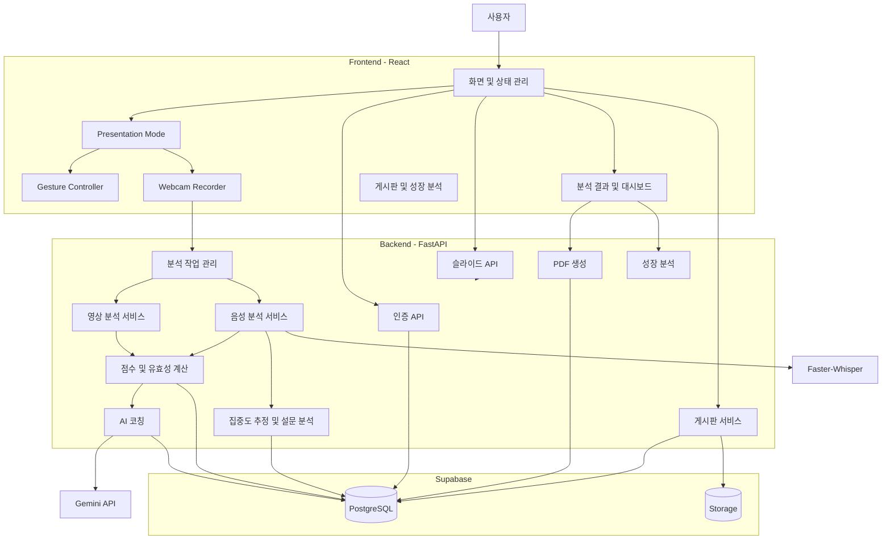
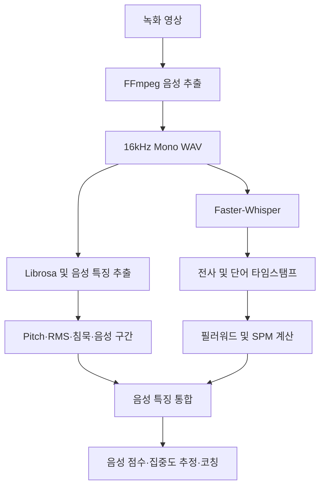
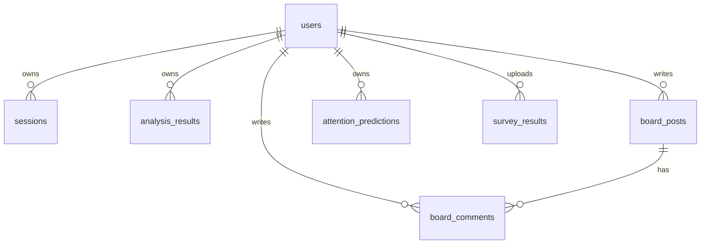

# Design Specification Document (DSD)
# 웹캠 기반 실시간 발표 분석 프로그램

| 항목 | 내용 |
|---|---|
| 종합설계 제목 | 웹캠 기반 실시간 발표 분석 프로그램 |
| 지도교수 | 서영석 |
| 팀장 | 안동규 |
| 팀원 | 김민서, 이보현, 이혜정, 전채현 |
| 주제 분류 | Data, AI |
| 작성일 | 2026년 11월 13일 |
| 버전 | 0.3 — 2학기 구현 내용 반영 |

---

## 문서 작성 기준

본 문서는 1학기 설계 내용을 바탕으로 2학기 구현 및 기능 확장 내용을 반영한 설계 명세서이다. 실제 코드에서 확인된 구조와 동작을 우선 기술하며, 구현 여부가 확인되지 않은 항목은 목표 또는 추가 확인 사항으로 구분한다.

- **발표 중 동작:** 웹캠 녹화, 브라우저 기반 손 제스처 인식 및 슬라이드 제어
- **발표 후 동작:** 업로드된 녹화 영상의 시선·자세·표정·제스처·음성 분석, 점수 산출, AI 코칭, 결과 저장 및 보고서 생성
- **별도 기능:** 청중 집중도 추정, 설문 데이터 분석 및 음성 지표 가중치 조정, 롤모델 비교, 성장 분석, 발표 영상 게시판
- **측정 원칙:** 분석에 필요한 데이터가 충분하지 않거나 검출에 실패한 항목은 0점으로 간주하지 않고 유효성 정보를 통해 구분한다.

※ API의 세부 경로·요청 필드·응답 필드는 실제 라우터와 프론트엔드 호출을 대조해 최종 확정해야 한다. 아래에서는 확인된 라우터 단위와 기능 중심으로 기술한다.

---

## 목차

1. 서론
   - 1.1 개요
   - 1.2 범위
   - 1.3 용어 정의
   - 1.4 설계 제한사항
   - 1.5 기술 명세
2. 시스템 아키텍처
   - 2.1 전체 시스템 구성
   - 2.2 계층별 역할
   - 2.3 데이터 흐름
3. 모듈별 설계
   - 3.1 회원 관리
   - 3.2 발표 환경 및 프롬프터
   - 3.3 영상 분석
   - 3.4 영상 녹화 및 제스처 제어
   - 3.5 음성 분석
   - 3.6 청중 집중도 추정 및 설문 데이터 분석
   - 3.7 AI 코칭
   - 3.8 점수화 및 측정 유효성
   - 3.9 롤모델 비교
   - 3.10 성장 분석
   - 3.11 게시판
   - 3.12 슬라이드 변환 및 관리
   - 3.13 PDF 보고서 생성
4. 데이터베이스 및 파일 저장 설계
   - 4.1 데이터베이스 구성
   - 4.2 주요 테이블
   - 4.3 파일 저장 및 수명주기
5. API 설계
   - 5.1 공통 사항
   - 5.2 인증
   - 5.3 슬라이드
   - 5.4 영상 분석
   - 5.5 히스토리 및 보고서
   - 5.6 청중 집중도 및 설문
   - 5.7 게시판
6. 프론트엔드 설계
   - 6.1 화면 및 기능 구성
   - 6.2 상태 관리
   - 6.3 주요 컴포넌트
7. 테스트 및 검증 계획
   - 7.1 단위 테스트
   - 7.2 통합 테스트
   - 7.3 검증 시 유의사항
8. 참고 문헌 및 구현 근거

---

# 1. 서론

## 1.1 개요

본 프로젝트는 PC 웹캠과 마이크를 이용해 발표자의 발표 영상을 수집하고, 발표 종료 후 영상 및 음성 데이터를 분석하여 발표 습관과 개선점을 제공하는 웹 기반 발표 분석 시스템이다.

발표 중에는 브라우저에서 웹캠 녹화와 손 제스처 인식을 수행한다. 손 제스처 인식 결과는 슬라이드 이전·다음 이동에 활용한다. 발표가 종료되면 녹화 영상이 서버로 전송되고, 백엔드에서 MediaPipe 기반 영상 분석과 음성 분석을 수행한다. 분석 결과는 점수화 알고리즘, AI 코칭, 롤모델 비교, 성장 분석 및 PDF 보고서 생성에 활용된다.

또한 발표자의 음성 특징을 바탕으로 청중 집중도를 추정하는 기능과 설문 데이터를 이용한 분석 기능을 제공한다. 게시판에서는 발표 영상을 공유하고 다른 발표자의 발표 결과를 확인할 수 있다.

단, 청중 집중도는 실제 청중의 표정이나 시선을 직접 측정한 값이 아니라 발표자의 음성 특징을 바탕으로 산출한 추정 지표이다. 또한 영상의 세부 시선·자세·표정 분석은 발표 중 실시간 분석이 아니라 발표 종료 후 업로드된 영상에 대한 사후 분석이다.

## 1.2 범위

| 구분 | 포함 범위 | 제외 또는 제한 범위 |
|---|---|---|
| 플랫폼 | PC 웹 브라우저 기반 애플리케이션 | 모바일 앱 및 태블릿 전용 앱 |
| 발표 진행 | 슬라이드 업로드, 발표 시간 설정, 슬라이드 전환, 웹캠·마이크 녹화 | 다중 발표자의 동시 분석 |
| 제스처 | 브라우저 손 랜드마크 인식 기반 슬라이드 제어 | 손동작을 이용한 모든 운영체제 제어 |
| 영상 분석 | 발표 후 시선, 자세, 표정, 제스처 및 습관 분석 | 발표 중 모든 영상 지표의 실시간 분석 |
| 음성 분석 | 음성 전사, 발화 속도, 필러워드, 침묵, 음높이 및 음량 특징 분석 | 전문 음성 치료·의학적 진단 |
| 집중도 | 발표자의 음성 특징 기반 청중 집중도 추정 | 실제 청중의 주의 상태 직접 측정 |
| AI 코칭 | 분석 지표 기반 발표 개선 피드백 생성 | 발표 내용의 사실성·전문성에 대한 완전한 평가 |
| 결과 관리 | 분석 결과 저장, 히스토리, 성장 비교, PDF 보고서 | 상용 결제 및 구독 관리 |
| 커뮤니티 | 발표 영상 게시, 검색, 댓글, 추천 | 실시간 화상 회의 및 실시간 공동 편집 |

## 1.3 용어 정의

| 용어 | 정의 |
|---|---|
| Landmark | MediaPipe가 얼굴·손·신체에서 검출하는 주요 지점의 좌표 |
| FaceMesh | 얼굴 랜드마크를 검출하여 시선 및 표정 관련 특징을 계산하는 모델 |
| Pose | 신체 주요 관절의 랜드마크를 검출하는 모델 |
| Hands / Hand Landmarker | 손 랜드마크를 검출하여 손 모양과 제스처를 판별하는 모델 |
| EAR | Eye Aspect Ratio. 눈 주변 랜드마크 간 거리 비율을 이용한 눈 감김 관련 지표 |
| MAR | Mouth Aspect Ratio. 입 주변 랜드마크 간 거리 비율을 이용한 입 모양 관련 지표 |
| Gaze | 얼굴 랜드마크를 바탕으로 추정하는 시선 방향 및 시선 이탈 관련 정보 |
| Gaze Heatmap | 영상에서 추정된 시선 좌표의 분포를 시각화한 결과 |
| SPM | Speech Per Minute. 분당 발화량을 나타내는 지표 |
| Filler Word | 발화 중 반복적으로 나타나는 군더더기 표현 또는 간투사 |
| VAD | Voice Activity Detection. 음성 구간과 비음성 구간을 구분하는 처리 |
| YIN / pYIN | 음성 신호의 기본 주파수(F0)를 추정하는 알고리즘 |
| RMS | Root Mean Square. 음성 신호의 에너지 크기를 계산하는 방법 |
| AHP | Analytic Hierarchy Process. 항목 간 상대적 중요도를 쌍대 비교하여 가중치를 산출하는 방법 |
| CR | Consistency Ratio. AHP 쌍대 비교 판단의 일관성을 나타내는 비율 |
| Measurement Validity | 특정 지표가 점수 계산에 사용될 수 있는지 판단하는 측정 유효성 정보 |
| NULL | 값이 측정되지 않았거나 유효하지 않아 점수로 사용할 수 없음을 나타내는 값 |
| Job ID | 비동기 영상 분석 작업을 식별하는 ID |
| SlideLog | 발표 중 각 슬라이드의 체류 시간 및 전환 기록 |
| Role Model | 발표 비교 기준으로 사용하는 참조 발표자 또는 발표 영상 |
| Attention Prediction | 발표자의 음성 특징을 입력으로 청중 집중도 지표를 추정하는 기능 |
| Signed URL | 비공개 Storage 객체에 일정 시간 접근할 수 있도록 발급하는 임시 URL |
| Spearman Correlation | 두 변수 사이의 순위 기반 연관성을 측정하는 상관계수 |

## 1.4 설계 제한사항

| 제한사항 | 설계 반영 |
|---|---|
| 웹캠 해상도, 카메라 각도 및 조명에 따른 검출 편차 | 분석 결과에 측정 유효성 정보를 포함하고, 검출이 불충분한 지표는 점수 계산에서 제외한다. |
| 2D 영상 기반 분석의 한계 | 깊이 정보를 직접 측정하지 않으며, 카메라 각도와 얼굴·체형 차이에 따라 결과가 달라질 수 있음을 안내한다. |
| 발표 중 브라우저 처리 자원 | 발표 중 손 제스처 인식과 녹화를 수행하고, 세부 영상 분석은 발표 종료 후 서버에서 처리한다. |
| 영상 분석 시간 | 분석 업로드 후 비동기 작업으로 처리하고 클라이언트가 작업 상태를 조회한다. |
| 음성 품질 | 주변 소음, 마이크 거리, 발음 및 녹음 환경에 따라 전사와 음성 특징 추정의 정확도가 달라질 수 있다. |
| 청중 집중도 추정의 간접성 | 발표자의 음성 특징을 이용한 추정값임을 명시하며 실제 청중의 집중도를 직접 측정한 값으로 해석하지 않는다. |
| AI 응답의 불확실성 | Gemini API 실패 시 규칙 기반 대체 코칭을 제공하며, 생성된 코칭은 참고 정보로 제공한다. |
| 데이터 부족 | 설문 표본 또는 분석 데이터가 충분하지 않은 경우 가중치 학습 결과를 확정된 모델 개선으로 간주하지 않는다. |
| 파일 용량 및 서버 자원 | 분석 영상과 게시판 영상에 별도 업로드 용량 제한을 적용한다. |
| 비동기 작업의 메모리 의존성 | 분석 작업 상태가 프로세스 메모리에 존재하므로 서버 재시작 시 진행 중 작업 상태가 유지되지 않을 수 있다. |
| 개인정보 보호 | 분석용 영상 파일의 서버 임시 저장과 삭제 절차를 적용한다. 게시판에 사용자가 직접 게시한 영상은 게시물의 저장 정책을 따른다. |

## 1.5 기술 명세

| 영역 | 기술 및 라이브러리 | 역할 |
|---|---|---|
| Frontend | React 19, Vite | 웹 사용자 인터페이스 |
| UI | Tailwind CSS 4 | 화면 스타일링 |
| 차트 | Recharts, Chart.js | 분석 결과 및 변화 시각화 |
| HTTP 통신 | Axios | 프론트엔드와 백엔드 통신 |
| Routing | React Router | 화면 이동 |
| Backend | Python, FastAPI, Uvicorn | REST API 서버 |
| 영상 처리 | OpenCV | 영상 프레임 추출 및 이미지 처리 |
| 영상 분석 | MediaPipe | 얼굴·자세·손 랜드마크 분석 |
| 음성 전사 | Faster-Whisper | 음성 인식 및 타임스탬프가 포함된 전사 |
| 음성 특징 | Librosa, YIN/pYIN, RMS, VAD 관련 처리 | 음높이, 음량, 침묵 등 음성 특징 추출 |
| AI 코칭 | Google Gemini API | 분석 지표 기반 코칭 텍스트 생성 |
| 인증 | python-jose, bcrypt | JWT 발급·검증 및 비밀번호 해싱 |
| Database | Supabase PostgreSQL | 사용자 및 분석 데이터 저장 |
| Storage | Supabase Storage | 게시판 영상 등 파일 저장 |
| PDF | ReportLab, Matplotlib | 분석 보고서 및 차트 생성 |
| 슬라이드 변환 | PyMuPDF, LibreOffice | PDF 및 PPT 계열 파일의 이미지 변환 |
| 데이터 분석 | NumPy, SciPy 등 사용 모듈 | 통계량 및 상관관계 계산 |

※ 실제 실행 환경의 Python 버전과 배포 플랫폼은 배포 설정 및 운영 환경을 기준으로 최종 기재한다. 라이브러리 목록은 프로젝트 의존성 파일과 실제 import를 기준으로 관리한다.

---

# 2. 시스템 아키텍처

## 2.1 전체 시스템 구성

시스템은 React 기반 클라이언트, FastAPI 기반 백엔드, Supabase 데이터 저장소 및 외부 AI·음성 처리 모듈로 구성된다.



발표 중 브라우저에서는 손 제스처 인식과 영상 녹화가 수행된다. 발표가 끝나면 영상 파일이 분석 API로 전송된다. 백엔드는 영상·음성 특징을 추출하고 점수 및 코칭을 생성한 후 결과를 데이터베이스에 저장한다. 별도의 집중도 분석 기능은 음성 특징과 설문 데이터를 이용한다.

---
### 2.2 계층별 역할

시스템은 프론트엔드, 백엔드, 데이터베이스 및 외부 서비스 계층으로 구성된다.

| 계층 | 구성 요소 | 주요 역할 |
|---|---|---|
| 프론트엔드 | React, Vite | 사용자 입력 처리, 발표 화면 제공, 분석 결과 시각화 |
| 발표 처리 | MediaRecorder, MediaPipe Hands | 발표 영상 녹화 및 손 제스처 기반 슬라이드 제어 |
| 백엔드 API | FastAPI | 사용자 요청 처리, 파일 업로드, 분석 작업 관리 |
| 영상 분석 | OpenCV, MediaPipe | 얼굴·자세·손 랜드마크 검출 및 영상 특징 분석 |
| 음성 분석 | FFmpeg, Faster-Whisper, Librosa | 음성 추출, 전사, 발화 및 음향 특징 분석 |
| AI 처리 | Gemini API | 분석 결과를 바탕으로 발표 코칭 생성 |
| 데이터 저장 | Supabase PostgreSQL | 사용자 정보, 발표 세션, 분석 결과 및 게시물 저장 |
| 파일 저장 | Supabase Storage | 게시판 발표 영상 등 파일 저장 |
| 보고서 생성 | ReportLab, Matplotlib | 분석 결과를 PDF 보고서로 변환 |

### 2.3 데이터 흐름

시스템의 전체 데이터 흐름은 발표 준비, 발표 진행, 영상 분석, 결과 제공의 네 단계로 구분한다.

**1단계: 발표 준비**

1. 사용자가 로그인한다.
2. 발표에 사용할 PDF 또는 PPT 계열 파일을 업로드한다.
3. 백엔드에서 파일 형식을 확인하고 슬라이드별 이미지로 변환한다.
4. 프론트엔드에서 변환된 슬라이드를 표시한다.
5. 사용자가 목표 발표 시간을 설정하고 발표를 준비한다.

**2단계: 발표 진행**

1. 브라우저에서 웹캠과 마이크 접근 권한을 요청한다.
2. MediaRecorder를 이용해 발표 영상을 녹화한다.
3. MediaPipe Hands를 이용해 손 제스처를 인식한다.
4. 인식된 제스처에 따라 슬라이드를 이전 또는 다음으로 이동한다.
5. 슬라이드 전환 시점과 체류 시간을 기록한다.
6. 발표가 종료되면 녹화 파일과 발표 기록을 정리한다.

**3단계: 영상 및 음성 분석**

1. 녹화 영상을 백엔드로 업로드한다.
2. 분석 작업을 생성하고 Job ID를 반환한다.
3. 영상 분석 모듈에서 얼굴, 자세, 표정 및 제스처 특징을 추출한다.
4. 음성 분석 모듈에서 음성을 추출하고 전사 및 음향 특징을 계산한다.
5. 측정 유효성을 확인하고 항목별 점수를 계산한다.
6. AI 코칭 및 기타 분석 결과를 생성한다.
7. 분석 결과를 데이터베이스에 저장한다.

**4단계: 결과 제공**

1. 프론트엔드가 분석 작업 상태를 조회한다.
2. 분석이 완료되면 결과 데이터를 불러온다.
3. 점수, 그래프, 히트맵, 타임라인 및 코칭 내용을 표시한다.
4. 사용자는 과거 분석 결과와 성장 추이를 확인할 수 있다.
5. 필요한 경우 PDF 보고서를 생성하고 다운로드한다.

---

# 3. 모듈별 설계

## 3.1 회원 관리 모듈

### 3.1.1 기능 설명

회원 관리 모듈은 사용자의 회원가입, 로그인, 사용자 정보 조회 및 비밀번호 변경 기능을 담당한다. 사용자 인증에는 JWT(JSON Web Token)를 사용하며, 비밀번호는 bcrypt를 이용해 해싱한 후 저장한다.

### 3.1.2 주요 기능

| 기능 | 설명 |
|---|---|
| 회원가입 | 사용자가 입력한 계정 정보를 검증하고 사용자 계정을 생성한다. |
| 로그인 | 사용자 인증 정보를 확인하고 JWT를 발급한다. |
| 사용자 정보 조회 | 로그인한 사용자의 계정 정보를 조회한다. |
| 비밀번호 변경 | 기존 인증 정보를 확인하고 새로운 비밀번호를 저장한다. |
| 인증 상태 관리 | 프론트엔드에서 토큰을 이용해 로그인 상태를 관리한다. |

### 3.1.3 처리 흐름

1. 사용자가 회원가입 또는 로그인 정보를 입력한다.
2. 프론트엔드에서 인증 API로 요청을 전송한다.
3. 백엔드에서 입력값을 검증한다.
4. 회원가입 시 비밀번호를 bcrypt로 해싱하여 저장한다.
5. 로그인 시 저장된 해시값과 입력된 비밀번호를 비교한다.
6. 인증에 성공하면 JWT를 발급한다.
7. 프론트엔드는 토큰을 저장하고 인증이 필요한 요청에 포함한다.

### 3.1.4 보안 설계

- 비밀번호는 평문으로 저장하지 않고 해싱하여 저장한다.
- JWT는 서명 검증을 통해 유효성을 확인한다.
- 인증이 필요한 API는 토큰을 검증한 후 요청을 처리한다.
- 토큰의 유효기간과 비밀키는 서버 설정을 통해 관리한다.

※ 실제 API별 인증 적용 여부와 사용자 권한 검사는 라우터 및 의존성 설정을 기준으로 최종 확인한다.

## 3.2 발표 환경 및 프롬프터 모듈

### 3.2.1 기능 설명

발표 환경 모듈은 사용자가 발표 자료를 업로드하고 슬라이드를 확인하면서 발표를 진행할 수 있도록 지원한다. 발표 중에는 슬라이드 전환, 발표 시간 측정, 웹캠·마이크 녹화 및 슬라이드별 체류 시간 기록을 수행한다.

### 3.2.2 주요 기능

| 기능 | 설명 |
|---|---|
| 발표 자료 업로드 | PDF 및 PPT 계열 파일 업로드 |
| 슬라이드 표시 | 변환된 슬라이드 이미지를 화면에 표시 |
| 슬라이드 전환 | 버튼, 키보드 및 손 제스처를 통한 슬라이드 이동 |
| 발표 시간 측정 | 발표 시작부터 종료까지 경과 시간 기록 |
| 웹캠 녹화 | 발표자의 영상과 음성을 녹화 |
| 슬라이드 기록 | 각 슬라이드의 전환 시점 및 체류 시간 기록 |

### 3.2.3 슬라이드 기록

슬라이드가 전환될 때 현재 슬라이드의 체류 시간을 기록한다. 발표 종료 시 기록한 SlideLog를 영상 분석 요청의 메타데이터로 함께 전송한다.

예시 구조:

```json
[
  {"slide": 0, "duration": 12.5},
  {"slide": 1, "duration": 28.2}
]
```

위 구조는 데이터 형태를 설명하기 위한 예시이며 실제 저장 필드와 인덱스 기준은 구현 코드를 따른다.

## 3.3 영상 분석 모듈

### 3.3.1 기능 설명

영상 분석 모듈은 발표 종료 후 업로드된 녹화 영상에서 얼굴, 신체 및 손 랜드마크를 검출하고 발표자의 비언어적 표현 특징을 계산한다. OpenCV를 이용해 영상을 읽고 MediaPipe의 FaceMesh, Pose, Hands를 이용해 분석한다.

주요 분석 항목은 시선, 자세, 표정, 제스처 및 발표 습관이다. 분석 결과는 원시 지표와 시간축 데이터, 측정 유효성 정보 및 근거 프레임으로 구성된다.

### 3.3.2 분석 항목

| 분석 영역 | 주요 입력 | 산출 정보 | 활용 |
|---|---|---|---|
| 시선 | 얼굴 랜드마크 | 시선 방향 추정, 시선 이탈 비율, 시간축 데이터 | 시선 점수, 히트맵, 코칭 |
| 자세 | Pose 랜드마크 | 어깨 기울기 등 자세 특징 | 자세 점수, 자세 습관 분석 |
| 표정 | 얼굴 랜드마크 | 미소·긴장·표정 변화 관련 특징 | 표정 분석 결과 및 시각화 |
| 제스처 | 손 랜드마크 | 손 검출 및 제스처 관련 통계 | 제스처 점수 및 습관 분석 |
| 습관 | 영상 분석 결과 | 반복적으로 관찰되는 시선·자세·제스처 패턴 | 발표 습관 진단 및 코칭 |

### 3.3.3 시선 분석

얼굴 랜드마크에서 눈과 코 등의 위치를 이용해 얼굴 방향 변화 및 시선 이탈 관련 값을 계산한다. 시선 분석 결과는 전체 영상의 통계값뿐 아니라 시간에 따른 변화 데이터로 구성할 수 있다.

시선 히트맵은 분석된 시선 좌표의 분포를 영상 또는 정규화된 화면 좌표에 시각화한 결과이다. 히트맵은 실제 눈동자 추적 장비와 동일한 정밀도를 보장하지 않으며 얼굴 검출, 카메라 각도 및 랜드마크 추정에 영향을 받는다.

### 3.3.4 자세 분석

Pose 랜드마크를 이용하여 어깨 위치와 기울기 등의 특징을 계산한다. 계산된 값은 자세 점수와 시간축 분석 및 습관 진단에 활용한다. 신체 전체의 3차원 움직임을 측정하는 것이 아니므로 카메라에 보이지 않는 신체 부위는 분석 범위에 포함되지 않는다.

### 3.3.5 표정 분석

FaceMesh 랜드마크를 이용해 미소, 얼굴 근육의 변화 및 표정 관련 특징을 계산한다. 표정 분석은 영상에서 관찰되는 시각적 특징을 추정하는 것이며 발표자의 실제 감정이나 심리 상태를 확정하는 기능은 아니다.

### 3.3.6 제스처 분석

Hands 모델을 이용해 손 랜드마크를 검출하고 영상 내 손의 등장 및 움직임 관련 통계를 계산한다. 발표 중 슬라이드 제어를 위한 브라우저 제스처 인식과 발표 후 영상에서 수행하는 제스처 분석은 별도의 처리 과정이다.

### 3.3.7 분석 유효성

얼굴이나 신체가 충분히 검출되지 않은 경우 해당 지표의 측정값을 정상적인 점수로 간주하지 않는다. 분석 결과에는 유효성 상태를 포함하고, 유효하지 않은 항목은 점수 산출에서 제외한다.

| 상태 | 의미 |
|---|---|
| ok | 해당 지표를 점수 산출에 사용할 수 있음 |
| partial | 일부 데이터만 확보되어 제한적으로 해석해야 함 |
| invalid | 측정 데이터가 부족하거나 검출 실패로 점수 산출에 사용할 수 없음 |

세부 임계값과 필드명은 분석 스키마 및 코드의 버전을 기준으로 관리한다.

## 3.4 영상 녹화 및 제스처 제어 모듈

### 3.4.1 기능 설명

영상 녹화 모듈은 브라우저의 getUserMedia 및 MediaRecorder API를 이용해 발표 중 웹캠과 마이크 스트림을 녹화한다. 발표 종료 후 녹화 파일을 분석 서버로 전송한다.

제스처 제어 모듈은 브라우저에서 MediaPipe Hands를 이용해 손 모양을 인식하고 슬라이드 이전·다음 이동 이벤트를 발생시킨다.

### 3.4.2 녹화 처리 흐름

1. 카메라 및 마이크 접근 권한을 요청한다.
2. MediaRecorder가 지원하는 MIME 형식을 확인한다.
3. 녹화를 시작하고 데이터 청크를 브라우저 메모리에 누적한다.
4. 발표 종료 시 녹화를 중지하고 Blob을 생성한다.
5. 설정된 경우 사용자가 선택한 로컬 폴더에 녹화 파일을 저장한다.
6. 분석을 위해 녹화 파일과 발표 메타데이터를 서버에 업로드한다.

### 3.4.3 제스처 제어

| 제스처 | 동작 |
|---|---|
| 왼손 주먹 | 이전 슬라이드 이동 |
| 오른손 주먹 | 다음 슬라이드 이동 |
| 핀치 | 포인터 표시 기능 |

※ 제스처의 좌우 방향과 화면 이동 방향은 실제 GestureController의 콜백 연결을 기준으로 최종 확인한다. 핀치 포인터는 시각적 포인터 기능이며, 별도 구현이 확인되지 않은 마우스 클릭 기능으로 기술하지 않는다.

### 3.4.4 파일 처리

분석용으로 서버에 업로드된 영상은 분석 작업에 사용된 후 임시 파일 삭제 절차를 수행한다. 게시판에 사용자가 별도로 등록한 영상은 게시판 Storage 저장 정책에 따라 관리되므로 분석용 임시 영상과 구분한다.

## 3.5 음성 분석 모듈

### 3.5.1 기능 설명

음성 분석 모듈은 발표 녹화 파일에서 음성 데이터를 추출하고 발화 내용 및 음향적 특징을 분석한다. Faster-Whisper를 이용해 한국어 음성을 전사하고, Librosa 및 관련 알고리즘을 이용해 음높이, 음량, 침묵 구간 등의 특징을 계산한다.

음성 분석 결과는 발표 점수, 청중 집중도 추정, 롤모델 비교, AI 코칭 및 성장 분석에 활용된다.

### 3.5.2 분석 항목

| 항목 | 설명 | 활용 |
|---|---|---|
| 음성 전사 | 음성을 텍스트로 변환하고 단어별 시간 정보를 확보 | 전사 결과 및 발화 분석 |
| SPM | 분당 발화량 | 발화 속도 분석 |
| 필러워드 | 발화 중 군더더기 표현의 출현 | 언어 습관 분석 |
| 침묵 구간 | 음성이 없는 구간과 긴 침묵 구간 | 발화 흐름 및 집중도 추정 |
| Pitch Variation | 기본 주파수의 변화 정도 | 단조로운 발화 분석 |
| RMS / dB | 음성 신호의 에너지 및 음량 관련 특징 | 음량 변화 분석 |
| Monotone | 음높이 변화가 제한적인 발화 특징 | 음성 점수 및 코칭 |

### 3.5.3 처리 흐름



### 3.5.4 유의사항

- 전사 결과는 녹음 품질과 발음, 배경 소음에 따라 오류가 발생할 수 있다.
- 침묵 구간은 VAD 및 설정된 기준에 따라 계산한다.
- Pitch는 모든 프레임에서 안정적으로 추정되지 않을 수 있다.
- 음량은 녹음 환경의 영향을 받으므로 절대적인 발표 음량 평가로 해석하지 않는다.
- 음성 지표가 확보되지 않은 경우 해당 지표는 유효성 규칙에 따라 점수 산출에서 제외한다.

## 3.6 청중 집중도 추정 및 설문 데이터 분석 모듈

### 3.6.1 기능 설명

청중 집중도 추정 모듈은 발표자의 음성 특징을 입력으로 받아 시간에 따른 집중도 추정 점수 및 관련 이벤트를 산출한다. 실제 청중의 시선이나 표정을 촬영해 집중도를 직접 측정하는 방식이 아니다.

설문 데이터 분석 기능은 CSV 파일을 입력받아 컬럼과 데이터 유효성을 검사하고, 분석에 사용할 수 있는 데이터를 정리한다. 일정 조건을 충족한 데이터는 음성 지표와 집중도 점수 사이의 관계 분석 및 가중치 조정에 활용한다.

### 3.6.2 집중도 추정 입력

| 입력 특징 | 설명 |
|---|---|
| Speech Rate / SPM | 발화 속도 |
| Silence | 침묵 구간 관련 특징 |
| Monotone | 음높이 변화가 제한적인 정도 |
| Pitch Variation | 음높이 변화 |
| dB / RMS | 음량 및 에너지 관련 특징 |

### 3.6.3 출력

- 집중도 추정 점수
- 시간 또는 구간별 집중도 변화
- 집중도 변화와 관련된 이벤트
- 분석에 사용된 음성 특징

집중도 점수의 기준값과 조정 규칙은 구현된 집중도 예측 모듈을 기준으로 관리한다. 이 점수는 실제 청중의 심리 상태를 측정한 값이 아니라 발표 음성 특징에 기반한 추정 지표이다.

### 3.6.4 설문 CSV 처리

현재 분석 코드가 기대하는 주요 CSV 컬럼은 다음과 같다.

| 컬럼 | 설명 |
|---|---|
| participant_id | 응답자 식별값 |
| spm | 발화 속도 |
| pitch_variation | 음높이 변화 |
| db | 음량 관련 값 |
| silence | 침묵 관련 값 |
| attention_score | 설문 또는 기준 집중도 점수 |
| feedback | 응답자의 피드백 |

CSV 업로드 시 필수 컬럼 존재 여부와 유효한 행의 수를 확인한다. 화면에서 제공하는 설문 양식과 백엔드가 기대하는 CSV 컬럼 형식이 다를 경우 변환 또는 매핑 절차가 필요하다. 두 형식이 동일하다고 가정하지 않는다.

### 3.6.5 음성 특징 가중치 조정

가중치 조정 모듈은 설문 데이터와 음성 특징 사이의 Spearman 상관관계를 이용한다. 구현 기준으로 최소 표본 수, 분석 대상 발표 수, 유의확률 조건 및 학습률을 적용한다.

| 조건 | 구현 기준 |
|---|---|
| 지표별 최소 유효 표본 | 8개 |
| 최소 발표 데이터 수 | 10개 |
| 통계적 유의성 | p < 0.05 |
| 가중치 조정 학습률 | 0.1 |
| 분석 방법 | Spearman 상관관계 |

가중치 조정 결과는 데이터 표본과 통계적 조건에 영향을 받는다. 상관관계는 인과관계를 의미하지 않으며, 표본 수가 충족되었다고 해서 모든 지표의 가중치가 반드시 변경되는 것은 아니다.

## 3.7 AI 코칭 모듈

### 3.7.1 기능 설명

AI 코칭 모듈은 영상 및 음성 분석 결과를 바탕으로 발표자의 강점과 개선점을 자연어로 생성한다. Gemini API를 호출하며, API 호출에 실패한 경우 규칙 기반 대체 코칭을 제공한다.

### 3.7.2 입력 및 출력

| 구분 | 내용 |
|---|---|
| 입력 | 시선·자세·제스처·표정·음성 분석 결과 및 유효성 정보 |
| 처리 | 분석 지표 정리, 프롬프트 생성, Gemini API 요청 |
| 출력 | 발표 요약, 항목별 진단, 개선 방법 및 연습 우선순위 |

실제 프롬프트에 전달되는 입력 필드는 코드 버전에 따라 관리한다. 이미지 프레임이 Gemini 프롬프트에 직접 전달되는지 여부는 별도 확인 없이 기능으로 기재하지 않는다. 문제 프레임은 분석 결과 및 PDF 보고서에서 근거 자료로 별도 표시한다.

### 3.7.3 처리 흐름

1. 영상 및 음성 분석 결과를 수집한다.
2. 유효하지 않은 지표와 누락값을 구분한다.
3. 사용 가능한 지표를 프롬프트 입력으로 정리한다.
4. Gemini API를 호출한다.
5. 정상 응답을 마크다운 코칭 텍스트로 저장한다.
6. 호출 실패 시 규칙 기반 fallback 코칭을 생성한다.
7. 결과 화면에서 섹션별 코칭을 표시한다.

### 3.7.4 유의사항

AI 코칭은 입력된 분석 지표에 근거한 보조 피드백이다. 측정되지 않은 항목을 실제 관찰된 사실처럼 설명하지 않도록 유효성 정보를 함께 고려해야 한다. 생성형 AI의 응답은 오류가 있을 수 있으므로 최종 판단을 대신하지 않는다.

## 3.8 점수화 및 측정 유효성 모듈

### 3.8.1 기능 설명

점수화 모듈은 영상 및 음성 분석 결과를 항목별 점수로 변환하고 AHP v2 가중치를 적용하여 종합 점수를 계산한다.

기존 설계의 시선 30%, 자세 25%, 제스처 15%, 시간 30% 가중합은 현재 구현 기준이 아니므로 사용하지 않는다. 현재 점수 산출은 시선·자세·제스처·음성의 AHP v2 가중치를 사용하며, 시간 점수는 별도 지표로 제공한다.

### 3.8.2 AHP v2 가중치

| 평가 항목 | 가중치 |
|---|---:|
| 시선(Gaze) | 35.12% |
| 자세(Pose) | 18.87% |
| 제스처(Gesture) | 10.89% |
| 음성(Voice) | 35.12% |
| 합계 | 100.00% |

※ 표시된 값은 구현된 AHP v2 가중치이다. 반올림으로 인해 합계가 100%와 미세하게 다르게 보일 수 있다. 시간(Time)은 위 종합 점수 가중치에 포함되지 않고 별도 점수로 관리한다.

### 3.8.3 가중치 산정 기준

AHP 쌍대 비교 행렬을 사용해 평가 항목의 상대적 중요도를 산출한다. 구현된 행렬의 일관성 비율은 CR=0.0038이다. 이 값은 팀에서 설정한 판단 행렬의 일관성을 나타내며, 외부 전문가 집단의 평가 결과를 의미하지 않는다.

### 3.8.4 결측값 및 유효성 처리

점수화 과정에서 측정되지 않은 항목을 0점으로 처리하지 않는다.

1. 각 지표의 측정 유효성을 확인한다.
2. 유효한 항목만 종합 점수 계산 대상으로 선택한다.
3. 제외된 항목의 가중치를 남은 유효 항목에 맞게 재정규화한다.
4. 유효한 측정값이 부족하면 종합 점수를 산출하지 않거나 측정 불가 상태로 표시한다.
5. 결과에는 항목별 유효성 및 측정 상태를 함께 제공한다.

이 방식은 측정 실패와 실제 낮은 성과를 구분하기 위한 것이다.

### 3.8.5 출력

| 출력 | 설명 |
|---|---|
| score_gaze | 시선 점수 |
| score_pose | 자세 점수 |
| score_gesture | 제스처 점수 |
| score_voice | 음성 점수 |
| score_time | 목표 시간 대비 별도 시간 점수 |
| score_total | 유효한 항목의 AHP 가중치를 반영한 종합 점수 |
| validity | 항목별 측정 유효성 정보 |
| weights_version | 점수 계산에 사용된 가중치 버전 |

세부 필드명은 현재 결과 스키마를 기준으로 맞춘다. 결과 데이터의 가중치 버전이 서로 다르면 성장 분석에서 종합 점수를 직접 비교하지 않도록 처리한다.

## 3.9 롤모델 비교 모듈

### 3.9.1 기능 설명

롤모델 비교 모듈은 사전에 등록된 참조 발표자의 음성 및 영상 분석 정보를 기준으로 사용자의 발표 특징을 비교한다. 참조 발표자의 특징값과 사용자의 분석 결과를 나란히 제시하여 발표 스타일의 차이를 확인하도록 지원한다.

### 3.9.2 비교 항목

| 영역 | 비교 특징 |
|---|---|
| 음성 | SPM, 필러워드, 침묵, 단조로움, Pitch |
| 영상 | 미소 및 표정 관련 특징 등 데이터가 확보된 항목 |
| 비교 기준 | 참조 발표자의 개별 값 또는 복수 참조 데이터의 범위 |

참조 데이터의 수와 항목별 제공 여부에 따라 비교 가능한 지표가 달라진다. 일부 기준값은 임시 또는 제한된 데이터에 기반할 수 있으므로 모든 비교 결과를 절대적인 우수성 판단으로 해석하지 않는다.

## 3.10 성장 분석 모듈

### 3.10.1 기능 설명

성장 분석 모듈은 사용자의 과거 발표 분석 결과를 조회하여 최근 발표와 이전 발표의 변화 추이를 비교한다. 점수 및 세부 지표의 변화, 개선이 필요한 항목과 다음 연습 방향을 제공한다.

### 3.10.2 처리 기준

- 사용자별 과거 분석 결과를 시간순으로 조회한다.
- 비교 가능한 분석 결과를 선정한다.
- 총점 및 세부 항목의 변화량을 계산한다.
- 가중치 버전이 다른 결과는 종합 점수의 직접 비교를 제한한다.
- 비교 데이터가 부족한 경우 성장 분석 결과를 제한적으로 표시한다.
- AI 성장 피드백 생성이 실패하면 규칙 기반 대체 피드백을 사용할 수 있다.

### 3.10.3 비교 항목

| 항목 | 설명 |
|---|---|
| 종합 점수 | 동일한 점수 정책을 사용하는 결과 간 변화 |
| 시선 | 시선 관련 점수 및 지표 변화 |
| 음성 | 음성 점수 및 세부 특징 변화 |
| 자세 | 자세 점수 및 지표 변화 |
| 제스처 | 제스처 점수 및 지표 변화 |
| 시간 | 목표 시간 대비 발표 시간 변화 |

## 3.11 게시판 모듈

### 3.11.1 기능 설명

게시판 모듈은 사용자가 발표 영상을 게시하고 다른 사용자의 발표 사례를 확인할 수 있도록 한다. 게시물에는 제목, 주제, 태그, 영상 파일 및 분석 결과 요약 정보가 포함될 수 있다.

### 3.11.2 주요 기능

| 기능 | 설명 |
|---|---|
| 게시물 작성 | 발표 영상, 제목, 주제, 태그 등을 등록 |
| 공개 범위 | 게시물 공개 여부 설정 |
| 게시물 목록 | 전체 게시물 및 내 게시물 조회 |
| 검색 및 필터 | 제목·주제·태그 기준 검색 및 필터 |
| 정렬 및 페이지네이션 | 정렬 조건에 따른 목록 조회 및 페이지 이동 |
| 상세 조회 | 영상 및 분석 스냅샷 표시 |
| 댓글 | 게시물에 댓글 작성 및 조회 |
| 삭제 | 작성자의 게시물 삭제 |
| 추천 | 유사 주제 및 분석 점수 등 규칙 기반 기준으로 추천 |

### 3.11.3 파일 처리

게시판 영상은 Supabase Storage에 저장하고 게시물 데이터와 연결한다. 비공개 파일에 대한 접근은 저장소 정책 및 서명 URL 발급 로직을 따른다. 분석 작업을 위해 서버에 임시 업로드되는 영상과 게시판에 보관되는 영상은 목적과 수명주기가 다르므로 구분한다.

### 3.11.4 추천 방식

현재 추천 기능은 주제 유사성 및 점수 등의 규칙을 이용한 방식이다. 별도 생성형 AI 추천 모델이 구현된 것으로 기술하지 않는다.

## 3.12 슬라이드 변환 및 관리 모듈

### 3.12.1 기능 설명

슬라이드 관리 모듈은 사용자가 업로드한 PDF 또는 PPT 계열 파일을 슬라이드별 이미지로 변환하여 브라우저에서 표시한다. PDF는 PyMuPDF를 이용하고 PPT 계열 파일은 LibreOffice 변환 과정을 이용한다.

### 3.12.2 처리 흐름

1. 사용자가 슬라이드 파일을 업로드한다.
2. 백엔드가 파일 형식을 확인한다.
3. 변환 모듈이 각 페이지를 PNG 이미지로 변환한다.
4. 세션별 디렉터리에 변환 이미지를 저장한다.
5. 프론트엔드가 이미지 URL 목록을 받아 슬라이드를 표시한다.
6. 발표 종료 시 해당 세션의 임시 슬라이드 파일을 정리한다.

### 3.12.3 표시 및 전환

SlideViewer는 현재 슬라이드를 표시하고 인접 슬라이드 이미지를 미리 불러와 전환 지연을 줄인다. 슬라이드 전환은 버튼, 키보드 및 제스처 입력을 통해 수행한다.

## 3.13 PDF 보고서 생성 모듈

### 3.13.1 기능 설명

PDF 보고서 모듈은 저장된 분석 결과를 이용해 발표 분석 내용을 문서 형태로 제공한다. ReportLab으로 PDF를 구성하고 Matplotlib으로 차트를 생성한다.

### 3.13.2 주요 내용

- 발표 날짜 및 종합 점수
- 시선·자세·제스처·음성 등 측정 지표
- 항목별 점수 및 차트
- 측정 유효성 및 측정 불가 항목 안내
- 문제 프레임 또는 근거 이미지(데이터가 있는 경우)
- AI 코칭 및 다음 연습 우선순위
- 롤모델 비교 등 보고서에 포함되도록 구현된 분석 항목

### 3.13.3 생성 및 반환

PDF는 백엔드에서 생성하며 현재 확인된 구현에서는 생성된 PDF 바이트를 HTTP 응답으로 반환한다. PDF를 Supabase Storage에 영구 저장하는 구조로 단정하지 않는다.

---

# 4. 데이터베이스 및 파일 저장 설계

## 4.1 데이터베이스 구성

데이터베이스는 Supabase PostgreSQL을 사용한다. 사용자 계정, 발표 세션, 분석 결과, 롤모델 정보, 청중 집중도 예측, 설문 결과, 음성 지표 가중치 및 게시판 정보를 저장한다.

현재 확인된 SQL 스키마에는 다음 10개 테이블이 정의되어 있다. 실제 운영 데이터베이스에 적용된 구조와 SQL 파일의 최신 상태는 별도로 대조해야 한다.

## 4.2 주요 테이블

| 테이블 | 주요 역할 |
|---|---|
| users | 사용자 계정 정보 |
| sessions | 발표 세션 및 슬라이드 기록 |
| analysis_results | 영상·음성 분석 결과, 점수, 코칭 및 유효성 정보 |
| reference_speakers | 롤모델 및 참조 발표자 데이터 |
| attention_predictions | 청중 집중도 추정 결과 |
| survey_results | 설문 CSV에서 수집한 데이터 |
| attention_weights | 집중도 추정에 사용되는 음성 지표 가중치 |
| board_posts | 발표 영상 게시물 및 공개 범위, 분석 스냅샷 |
| board_comments | 게시물 댓글 |

※ SQL 스키마에 추가 필드나 별도 테이블이 존재하는 경우 운영 DB 및 최신 schema.sql을 기준으로 반영한다. 테이블 이름만으로 실제 외래 키 관계나 RLS 정책이 정상 적용되었다고 단정하지 않는다.

## 4.2.1 핵심 데이터 관계



위 ERD는 기능상 주요 데이터 소유 관계를 개념적으로 나타낸다. 실제 외래 키 관계는 운영 DB의 DDL을 확인해 최종 확정해야 한다. 기존 ER 다이어그램과 SQL 파일 사이에 테이블명·컬럼·관계 차이가 있을 수 있으므로 문서 제출 전 동기화가 필요하다.

## 4.3 파일 저장 및 수명주기

| 파일 종류 | 저장 위치 및 처리 |
|---|---|
| 발표 슬라이드 이미지 | 서버의 세션별 임시 디렉터리에 저장 후 발표 종료 시 정리 |
| 분석용 녹화 영상 | 분석을 위해 서버 임시 경로에 저장하고 분석 종료 후 삭제 처리 |
| 게시판 발표 영상 | Supabase Storage에 저장하고 게시물 데이터와 연결 |
| 분석 근거 프레임 | 분석 결과 데이터에 포함되는 이미지 데이터로 관리 |
| PDF 보고서 | 생성 후 HTTP 응답으로 반환 |

분석용 영상과 게시판 영상은 서로 다른 목적의 파일이다. 분석용 영상은 작업 처리 후 삭제되지만, 사용자가 게시판에 등록한 영상은 게시물의 삭제 및 저장 정책에 따라 관리한다.

---

# 5. API 설계

## 5.1 공통 사항

- Backend: FastAPI
- API Prefix: `/api`
- 인증: JWT Bearer Token
- 요청 형식: JSON 또는 multipart/form-data
- 파일 업로드: 확장자와 크기를 검증한 뒤 처리
- 오류 응답: HTTP 상태 코드 및 오류 메시지 사용

인증이 필요한 API에는 Authorization 헤더를 포함한다.

```http
Authorization: Bearer {access_token}
```

## 5.2 인증 API

| 메서드 | 경로 | 기능 |
|---|---|---|
| POST | `/api/auth/signup` | 회원가입 |
| POST | `/api/auth/login` | 로그인 |
| GET | `/api/auth/me` | 현재 사용자 정보 조회 |
| POST | `/api/auth/change-password` | 비밀번호 변경 |

요청·응답 필드와 상태 코드는 auth router의 Pydantic 모델 및 실제 응답을 기준으로 관리한다.

## 5.3 슬라이드 API

슬라이드 라우터는 파일 업로드, 변환된 슬라이드 이미지 정보 반환 및 세션 파일 삭제 기능을 담당한다.

| 메서드 | 경로 | 기능 |
|---|---|---|
| POST | `/api/slides/upload` | 슬라이드 업로드 및 이미지 변환 |
| DELETE | `/api/slides/{session_id}` | 해당 세션의 슬라이드 파일 삭제 |

허용 파일 형식 및 업로드 제한은 실제 설정값과 배포 환경을 기준으로 유지한다.

## 5.4 영상 분석 API

영상 분석 라우터는 녹화 영상 업로드, 비동기 분석 작업 생성 및 작업 상태 조회를 담당한다.

| 메서드 | 경로 | 기능 |
|---|---|---|
| POST | `/api/analysis/upload` | 영상 업로드 및 분석 작업 생성 |
| GET | `/api/analysis/{job_id}` | 분석 작업 상태 및 결과 조회 |

### 업로드 데이터

| 필드 | 설명 |
|---|---|
| file | 발표 녹화 영상 |
| goal_sec | 목표 발표 시간 |
| elapsed_sec | 실제 발표 시간 |
| slide_log | 슬라이드 전환 및 체류 시간 데이터 |
| rolemodel_id | 비교할 롤모델 식별값(선택) |

분석 작업은 비동기 방식으로 실행되며 프론트엔드는 job_id를 이용해 상태를 조회한다. 업로드 허용 형식 및 최대 크기는 실제 설정 파일의 제한값을 기준으로 한다.

분석 결과에는 영상·음성 지표, 점수, 코칭, 유효성 및 분석 결과 식별 정보가 포함될 수 있다. 세부 응답 스키마는 현재 analysis schema 버전을 기준으로 관리한다.

## 5.5 히스토리 및 보고서 API

| 기능 | 경로 |
|---|---|
| 분석 기록 목록 | `/api/history` |
| 분석 결과 상세 | `/api/history/{result_id}` |
| 성장 분석 | `/api/history` 하위 성장 분석 라우트 |
| PDF 보고서 | `/api/history/{result_id}/pdf` |

※ 위 표에서 하위 성장 분석 라우트의 정확한 URL은 실제 history router의 선언과 프론트엔드 호출을 대조해 기재한다. 경로를 임의로 생성하지 않는다.

## 5.6 청중 집중도 및 설문 API

청중 집중도 라우터는 음성 특징 기반 집중도 추정 결과 조회 및 설문 CSV 업로드·분석 기능을 담당한다.

| 기능 | 설명 |
|---|---|
| 집중도 예측 | 분석 결과의 음성 특징을 이용해 집중도 점수 및 시간축 결과 생성 |
| 설문 업로드 | CSV 파일의 컬럼 및 데이터 유효성 검사 |
| 설문 분석 | 유효한 응답 데이터의 통계 및 관계 분석 |
| 가중치 조정 | 표본 수와 통계적 조건이 충족되는 경우 음성 특징 가중치 갱신 |

정확한 엔드포인트와 필드명은 `audience` 라우터와 프론트엔드 API 호출부를 기준으로 작성한다.

## 5.7 게시판 API

게시판 라우터는 게시물 작성·조회·검색·삭제, 댓글 및 추천 기능을 제공한다.

| 기능 | 설명 |
|---|---|
| 게시물 목록 | 전체 또는 사용자 본인의 게시물 조회 |
| 게시물 검색 | 제목·주제·태그 기준 검색 |
| 게시물 상세 | 영상 및 분석 스냅샷 조회 |
| 게시물 작성 | Storage 영상 업로드 후 게시물 등록 |
| 게시물 삭제 | 게시물 삭제 |
| 댓글 | 댓글 작성 및 조회 |
| 추천 | 주제 및 분석 정보를 이용한 규칙 기반 추천 |

정확한 메서드·경로·요청 모델·인증 조건은 `board` 라우터와 프론트엔드 API 클라이언트의 실제 호출을 기준으로 부록 또는 별도 API 표에 기재한다.

---

# 6. 프론트엔드 설계

## 6.1 화면 및 기능 구성

| 화면/기능 | 주요 역할 |
|---|---|
| Login | 회원가입 및 로그인 |
| Home | 대시보드, 최근 분석 결과, 주요 기능 진입 |
| PresentationMode | 슬라이드 업로드, 발표 시간 설정, 발표 진행 |
| SlideViewer | 슬라이드 표시 및 전환 |
| GestureController | 손 제스처 인식 및 슬라이드 제어 |
| WebcamRecorder | 웹캠·마이크 녹화 |
| VideoAnalysis | 녹화 영상 업로드 및 분석 진행 상태 표시 |
| CoachingResult | 종합 분석 결과 및 AI 코칭 |
| ResultTabs | 점수·타임라인·시각화·음성·롤모델 분석 탭 |
| History | 분석 기록 목록 및 상세 조회 |
| Growth | 과거 발표 결과 비교 및 성장 피드백 |
| PredictAttention | 청중 집중도 결과 및 설문 데이터 업로드 |
| BoardList | 게시판 목록, 검색, 필터 및 정렬 |
| BoardWrite | 발표 영상 게시물 작성 |
| BoardDetail | 게시물 상세, 영상, 분석 정보 및 댓글 |

실제 라우팅 경로는 현재 React Router 설정을 기준으로 문서화한다. 화면 이름과 URL 경로가 항상 일치하는 것은 아니므로 컴포넌트 이름만으로 경로를 추정하지 않는다.

## 6.2 상태 관리

| 상태 영역 | 관리 방식 | 주요 내용 |
|---|---|---|
| 인증 | AuthContext | 사용자 정보, 로그인 여부, JWT 토큰 |
| 인증 토큰 | localStorage | 로그인 토큰 저장 |
| 발표 설정 | localStorage | 사용자 발표 설정 |
| 발표 세션 | PresentationMode 내부 상태 | 슬라이드, 타이머, 녹화 상태, SlideLog |
| 영상 분석 | VideoAnalysis 내부 상태 | 업로드 파일, Job ID, 분석 단계 및 결과 |
| 분석 결과 탭 | ResultTabs 내부 상태 | 현재 선택한 분석 탭 |
| 게시판 | 각 페이지 내부 상태 | 검색어, 필터, 정렬, 페이지 및 게시물 정보 |

## 6.3 주요 컴포넌트

| 컴포넌트 | 주요 역할 |
|---|---|
| AuthContext | JWT 기반 인증 상태 관리 |
| PresentationMode | 발표 화면 및 발표 종료 처리 |
| SlideViewer | 슬라이드 이미지 표시 및 키보드 전환 |
| SlideControls | 발표 시간 및 슬라이드 제어 UI |
| WebcamRecorder | 웹캠·마이크 녹화 |
| GestureController | 손 제스처 인식 |
| VideoUpload | 분석용 영상 업로드 |
| AnalysisProgress | 분석 작업 진행 상태 표시 |
| CoachingResult | 점수 및 코칭 결과 표시 |
| TimelineTab | 시간축별 분석 결과 |
| VisualTab | 시선 히트맵 및 표정 관련 시각화 |
| VoiceTab | 음성 지표 및 전사 결과 |
| RoleModelTab | 롤모델 비교 결과 |
| History | 분석 기록 조회 |
| Growth | 성장 분석 |
| PredictAttention | 집중도 결과 및 설문 데이터 처리 |
| BoardList | 게시물 목록 |
| BoardWrite | 게시물 작성 |
| BoardDetail | 게시물 상세 및 댓글 |

---

# 7. 테스트 및 검증 계획

## 7.1 단위 테스트

| 모듈 | 테스트 항목 | 검증 내용 |
|---|---|---|
| 인증 | 비밀번호 해싱 및 JWT | 회원가입·로그인·토큰 검증 |
| 영상 분석 | 얼굴·자세·손 검출 | 정상 영상 및 검출 실패 상황 |
| 시선 분석 | 시선 관련 지표 | 좌표 계산 및 유효성 처리 |
| 표정 분석 | 표정 관련 특징 | 랜드마크 누락 및 값 범위 |
| 음성 분석 | 전사 및 음향 특징 | 전사 결과, SPM, 침묵, Pitch 등 |
| 점수화 | AHP v2 | 가중치 적용 및 점수 범위 |
| 유효성 | 측정 실패 처리 | 누락 지표가 0점으로 처리되지 않는지 확인 |
| 집중도 | 집중도 추정 | 입력 음성 특징과 시간축 결과 |
| 설문 분석 | CSV 검증 | 필수 컬럼, 유효 행, 표본 수 조건 |
| 가중치 조정 | Spearman 분석 | 표본 수와 유의확률 조건 |
| 롤모델 | 참조 데이터 비교 | 참조 데이터 누락 및 비교 범위 |
| 성장 분석 | 결과 비교 | 가중치 버전 차이 처리 |
| 게시판 | 게시물·댓글 | 공개 범위, 검색, 삭제 및 파일 연결 |
| PDF | 보고서 생성 | 한글 폰트, 차트, 누락 지표 표시 |

## 7.2 통합 테스트

| 시나리오 | 절차 | 확인 내용 |
|---|---|---|
| 발표 전체 흐름 | 로그인 → 슬라이드 업로드 → 발표 → 종료 → 영상 업로드 | 발표 세션과 분석 요청 연결 |
| 제스처 제어 | 발표 중 손 제스처 수행 | 슬라이드 이동 이벤트 정상 동작 |
| 영상 분석 | 녹화 영상 업로드 | 비동기 작업 및 결과 저장 |
| 음성 분석 | 음성이 포함된 영상 업로드 | 전사 및 음성 지표 생성 |
| 측정 실패 | 얼굴 또는 음성 데이터가 불충분한 영상 입력 | 해당 지표의 유효성 및 점수 제외 |
| AI 코칭 | 분석 완료 후 코칭 생성 | 정상 응답 및 fallback |
| 집중도 추정 | 음성 특징으로 집중도 결과 생성 | 점수와 시간축 데이터 |
| 설문 CSV | 형식이 맞는 CSV 및 잘못된 CSV 업로드 | 컬럼 검증과 오류 처리 |
| 롤모델 비교 | 참조 발표자 선택 후 분석 | 비교 데이터 표시 |
| 성장 분석 | 복수 분석 결과 비교 | 가중치 버전 및 누락 데이터 처리 |
| 게시판 | 영상 게시·검색·상세·댓글 | Storage와 게시물 데이터 연결 |
| PDF | 결과 화면에서 보고서 다운로드 | PDF 생성 및 한글·차트 표시 |

## 7.3 검증 시 유의사항

1. **테스트 목표와 테스트 결과를 구분한다.** 테스트 계획에 적힌 수치가 실제 측정된 성능 결과인 것처럼 작성하지 않는다.
2. **정확도 수치는 검증 데이터와 산출 방법이 있을 때만 기재한다.** 별도 검증이 없는 경우 정량적 정확도를 주장하지 않는다.
3. **측정 유효성을 검증한다.** 얼굴 미검출, 음성 미검출, 일부 지표 누락 상황에서 0점으로 오인되지 않는지 확인한다.
4. **환경별 편차를 확인한다.** 카메라 해상도, 조명, 마이크 및 브라우저에 따라 결과가 달라질 수 있다.
5. **서버 재시작 상황을 확인한다.** 비동기 작업 상태가 메모리에 저장되는 구조에서는 서버 재시작 시 진행 상태가 유지되지 않을 수 있다.
6. **실제 배포 상태를 구분한다.** Dockerfile 및 배포 설정 파일의 존재만으로 운영 배포가 완료되었다고 판단하지 않는다.
7. **운영 DB를 대조한다.** SQL 파일과 실제 Supabase DB의 테이블·컬럼·정책이 동일한지 확인한다.

---

# 8. 참고 문헌 및 구현 근거

## 8.1 기술 참고 문헌

1. Google MediaPipe Documentation, https://developers.google.com/mediapipe
2. Google AI Edge, MediaPipe Hand Landmarker, https://ai.google.dev/edge/mediapipe/solutions/vision/hand_landmarker
3. Google AI Edge, MediaPipe Face Landmarker, https://ai.google.dev/edge/mediapipe/solutions/vision/face_landmarker
4. Google AI Edge, MediaPipe Pose Landmarker, https://ai.google.dev/edge/mediapipe/solutions/vision/pose_landmarker
5. Faster-Whisper, https://github.com/SYSTRAN/faster-whisper
6. Librosa Documentation, https://librosa.org/doc/latest/index.html
7. FastAPI Documentation, https://fastapi.tiangolo.com/
8. Supabase Documentation, https://supabase.com/docs
9. ReportLab Documentation, https://docs.reportlab.com/
10. MDN Web Docs, MediaRecorder API, https://developer.mozilla.org/en-US/docs/Web/API/MediaRecorder

## 8.2 프로젝트 내부 구현 근거

다음 프로젝트 파일을 기준으로 설계 내용을 관리한다. 파일 경로는 저장소 구조에 따라 달라질 수 있으므로 실제 main 브랜치의 최신 경로를 확인한다.

| 영역 | 주요 구현 파일 또는 구성 |
|---|---|
| 영상 분석 | `backend/app/services/video_analyzer.py` |
| 음성 분석 | `backend/app/services/audio_analyzer.py`, 음성 특징 처리 모듈 |
| 점수화 | `backend/app/services/score_calculator.py` |
| 측정 스키마 | `backend/app/services/analysis_schema.py` |
| 습관 분석 | `backend/app/services/habit_detector.py` |
| 집중도 추정 | `backend/app/services/predict_concentration.py` |
| 가중치 조정 | `backend/app/services/update_weight.py` |
| AI 코칭 | `backend/app/services/rolemodel.py` 및 코칭 관련 서비스 |
| 롤모델 데이터 | `reference_data/speakers.json` 및 로딩 모듈 |
| 성장 분석 | `growth_schema.py`, `growth_feedback.py` |
| PDF 보고서 | `backend/app/services/report_generator.py` |
| 슬라이드 변환 | `backend/app/services/slide_converter.py` |
| API 라우터 | `auth`, `slides`, `analysis`, `history`, `audience`, `board` |
| 프론트엔드 발표 | `PresentationMode.jsx`, `SlideViewer.jsx`, `GestureController.jsx`, `WebcamRecorder` |
| 프론트엔드 결과 | `CoachingResult.jsx`, `ResultTabs`, `TimelineTab`, `VisualTab`, `VoiceTab`, `RoleModelTab` |
| 프론트엔드 커뮤니티 | `BoardList.jsx`, `BoardWrite.jsx`, `BoardDetail.jsx` |
